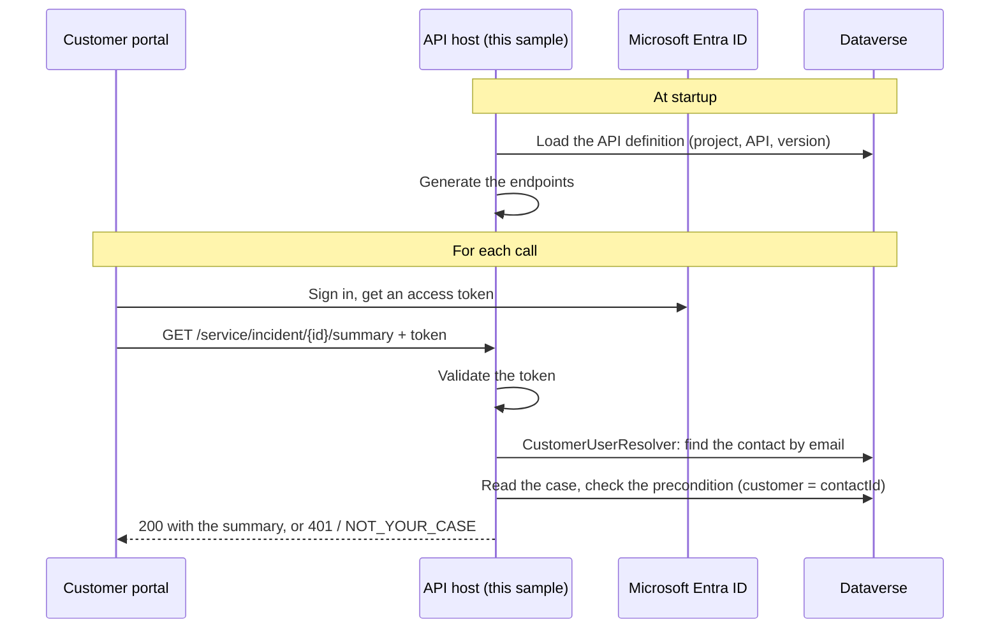

# Logic API host sample

[](../../actions/workflows/build.yml)

An ASP.NET Core application that hosts a **Logic API** designed in Logic Fabric API Studio. It serves the **Customer Portal API** from the [Logic Fabric case management tutorial](https://docs.flowon.com/tutorials/case-management-6-expose/): customers of a service desk sign in and read the summary of their own cases, and nobody else's.

Use it as a starting point for your own host: change two settings to serve your own API, and adapt the user resolver to your sign-in system.

```http
GET https://localhost:7275/service/incident/3f2a9c1e-5b7d-4e8a-9f10-2c3d4e5f6a7b/summary
Authorization: Bearer eyJ0eXAiOi...
```

```json
{
  "title": "Router drops connection",
  "ticketnumber": "CAS-01001-A1B2C3",
  "prioritycode": 1,
  "statuscode": 1,
  "createdon": "2026-10-19T09:00:00Z"
}
```

## Contents

- [How it works](#how-it-works)
- [Prerequisites](#prerequisites)
- [Set up](#set-up)
- [Run and test](#run-and-test)
- [Configuration](#configuration)
- [The user resolver](#the-user-resolver)
- [Versions and updates](#versions-and-updates)
- [Deploy to Azure App Service](#deploy-to-azure-app-service)
- [Serve your own API](#serve-your-own-api)
- [Troubleshooting](#troubleshooting)
- [Learn more](#learn-more)

## How it works



The host is a thin shell. The endpoints, their inputs and outputs, authorization policies and preconditions all come from the API you design in API Studio. The host adds three things the API can't know:

| Part | File | What it does |
| --- | --- | --- |
| Hosting and sign-in | [`Program.cs`](src/CaseManagementApiHost/Program.cs) | Connects to Dataverse, validates bearer tokens, registers the Logic API runtime and maps the endpoints. |
| Who the caller is | [`CustomerUserResolver.cs`](src/CaseManagementApiHost/CustomerUserResolver.cs) | Turns the signed-in caller into a Logic API user: signed in or not, a known customer or not, and the `contactId` user property. |
| Browse and try (Development only) | [`Program.cs`](src/CaseManagementApiHost/Program.cs) | Swagger UI lists the generated endpoints with their inputs and outputs, and lets you call them with a token. |
| Which version | [`ApiVersionSetting.cs`](src/CaseManagementApiHost/ApiVersionSetting.cs) | Reads `LogicApi:Version` (`draft`, `latest` or `1.0`), so each environment serves its own version without a code change. |

The contact lookup is in [`DataverseCustomerDirectory.cs`](src/CaseManagementApiHost/DataverseCustomerDirectory.cs), behind the [`ICustomerDirectory`](src/CaseManagementApiHost/ICustomerDirectory.cs) interface, so you can replace it with your own customer store and test the resolver without Dataverse.

## Prerequisites

- [.NET 10 SDK](https://dotnet.microsoft.com/download) and Visual Studio 2026, Visual Studio Code with the C# Dev Kit, or another editor.
- A Dataverse environment (or Dynamics 365 Customer Engagement) with Logic Fabric and the **Logic Fabric API Builder** and **Logic Fabric API Builder Tools** solutions installed.
- The **Customer Portal API** from [Part 6 of the tutorial](https://docs.flowon.com/tutorials/case-management-6-expose/), published at least once, or your own API.
- A Microsoft Entra ID tenant where you can create app registrations.

## Set up

### 1. Design and publish the API

Follow [Part 6: Expose it](https://docs.flowon.com/tutorials/case-management-6-expose/#design-the-portal-endpoint). You end up with:

| In API Studio | Value |
| --- | --- |
| Project | `Case Management` |
| API | `Customer Portal API` |
| User property (Context > User) | `contactId`, type **Unique Identifier** |
| Module, entity, action | `Service`, `incident` (Case), Read action `summary` |
| Access control | **Demand Authenticated User**; precondition: the case's customer equals `contactId`, error `NOT_YOUR_CASE` |

Publish a version (for example **Publish Major Version**, which creates `1.0`). To try the API before publishing, run the host with `LogicApi:Version` set to `draft`, which is the default in the Development environment.

### 2. Give the host a Dataverse identity

The host connects to Dataverse as an [application user](https://learn.microsoft.com/power-platform/admin/manage-application-users):

1. In Microsoft Entra ID, create an app registration for the host (for example `Case Management API host`) and add a client secret or a certificate.
2. In the Power Platform admin center, add it as an application user of the environment.
3. Give the application user these security roles:
   - **Logic Fabric API User**, to read the API and its versions;
   - a role with **Read** on **Case** (what the API exposes) and **Contact** (what the user resolver looks up);
   - **Logic Fabric User**, only if your API runs logic blocks or flows exposed as Dataverse actions.

### 3. Register the API for sign-in

Callers request tokens for the API, and the host validates them:

1. Create a second app registration, `Customer Portal API`.
2. Under **Expose an API**, set the **Application ID URI** (for example `api://<client-id>`) and add a scope such as `Cases.Read`.
3. Under **Manifest**, set `"requestedAccessTokenVersion": 2`, so the tokens match the v2.0 authority the host uses.
4. Note the **Directory (tenant) ID** and the **Application (client) ID**.

The portal's own app registration then requests the `Cases.Read` scope. For customers outside your organization, use [Microsoft Entra External ID](https://learn.microsoft.com/entra/external-id/) and its authority instead; the host only needs the authority and the audience.

### 4. Configure the host

Clone the repository and set the sign-in values in [`appsettings.json`](src/CaseManagementApiHost/appsettings.json):

```json
"Authentication": {
  "Authority": "https://login.microsoftonline.com/<tenant-id>/v2.0",
  "Audience": "<customer-portal-api-client-id>"
}
```

The Dataverse connection string contains a secret, so keep it out of `appsettings.json` and source control. Store it with [user secrets](https://learn.microsoft.com/aspnet/core/security/app-secrets) (the project already has a `UserSecretsId`):

```bash
cd src/CaseManagementApiHost
dotnet user-secrets set "ConnectionStrings:Dataverse" "AuthType=ClientSecret;Url=https://contoso.crm.dynamics.com/;ClientId=<host-client-id>;ClientSecret=<secret>"
```

In Visual Studio, you can also right-click the project and select **Manage User Secrets**.

## Run and test

1. Open `CaseManagementApiHost.slnx` and press **F5**, or run `dotnet run --project src/CaseManagementApiHost`.

   At startup the host connects to Dataverse and loads the API. If the project or API name is wrong, or the version doesn't exist, it stops with an error that says so.

2. The browser opens Swagger UI at `https://localhost:7275/swagger`, which lists every endpoint the API generated, with its inputs and outputs. To call one that needs a signed-in caller, select **Authorize**, paste an access token (without the `Bearer` prefix) and select **Try it out** on the endpoint.

   Swagger is added only when `ASPNETCORE_ENVIRONMENT` is `Development`, as in the launch profiles. In other environments `/swagger` doesn't exist, so the API description isn't published.

   `https://localhost:7275/health` names the project, the API and the version the host loaded, and whether it's healthy.

3. Or open [`CaseManagementApiHost.http`](src/CaseManagementApiHost/CaseManagementApiHost.http), paste an access token and two case IDs, and send the requests:

   | Request | Expected answer |
   | --- | --- |
   | No token | `401` with `UNAUTHORIZED_ACCESS` |
   | A customer, for a case of their own | `200 OK` with the summary |
   | A customer, for another customer's case | Refused with `NOT_YOUR_CASE` and `You can only view your own cases.` |
   | A case that doesn't exist | `404 Not Found` |

   The test customer must exist as an active contact whose **Email** matches the sign-in name in the token, and must be the **Customer** of the case.

4. Run the unit tests with `dotnet test`, or from **Test Explorer** in Visual Studio.

## Configuration

Settings are read from `appsettings.json`, then `appsettings.{Environment}.json`, user secrets (Development only), and environment variables. In environment variables and App Service settings, replace `:` with `__`, for example `LogicApi__Version`.

| Setting | Default | Description |
| --- | --- | --- |
| `ConnectionStrings:Dataverse` | none, required | Dataverse connection string of the host's application user. A secret: never commit it. |
| `LogicApi:Project` | `Case Management` | The Logic Fabric project, exactly as named in the Logic Fabric API Builder app. |
| `LogicApi:Api` | `Customer Portal API` | The API, exactly as named in the app. |
| `LogicApi:Version` | `latest` (`draft` in Development) | `draft`, `latest` or a published version such as `1.0`. |
| `LogicApi:MetadataWatchIntervalMinutes` | `5` (`1` in Development) | How often to check for a changed draft or a newer version. `0` turns the check off. |
| `Authentication:Authority` | placeholder | The token issuer, for example `https://login.microsoftonline.com/<tenant-id>/v2.0`. |
| `Authentication:Audience` | placeholder | The audience in the tokens, usually the API's application (client) ID. |
| `Customers:CacheMinutes` | `10` (`1` in Development) | How long a customer lookup is cached. A deactivated contact keeps access until their entry expires. |

## The user resolver

API Studio defines *what* the API knows about a caller: here, the `contactId` user property. The resolver supplies the *value* for each caller:

| Caller | Resolver returns | Effect |
| --- | --- | --- |
| No valid token | `New(isAuthenticated: false)` | **Demand Authenticated User** answers `401`. |
| Signed in, no active contact with that email | `New(true, isRegistered: false)` | Also refused: a valid token alone isn't enough. |
| Signed in, contact found | `New(true, true, { contactId })` | The precondition compares the case's customer with `contactId`. |

Rules to keep in mind when you change it:

- **Names and types must match API Studio.** The dictionary key must be the user property name, and the value the matching .NET type (`Guid` for **Unique Identifier**, `string` for **Text**, `int` for **Whole Number** and **Choice**, `EntityReference` for **Lookup**). An unknown name or a wrong type fails the request with a server error.
- **Take values only from trusted sources:** the token or your own data, never request headers or the body. User properties decide which records a caller can reach.
- **API roles** are returned as a list of role names, exactly as defined under **Context > Roles**, with `New(isAuthenticated, isRegistered, properties, roles)`. This API has no roles.

See [Implement the user resolver](https://docs.flowon.com/logic-api/host/user-resolver/) for every option, including running Dataverse calls as the caller.

## Versions and updates

The host serves exactly one version of the API, chosen by `LogicApi:Version`:

| Environment | `LogicApi:Version` | Metadata watcher |
| --- | --- | --- |
| Development | `draft`: designers see their changes without publishing | On, every minute |
| Test | `latest`: every published version is tested as soon as it exists | On |
| Production | `1.0`: you choose when callers move to a new version | Not needed |

With `draft` or `latest`, the metadata watcher checks Dataverse every `MetadataWatchIntervalMinutes` minutes. When the draft changed or a newer version was published, it **stops the host**, and the hosting platform starts it again with the new version. App Service, container platforms with a restart policy, and IIS do this; a process you started by hand stays stopped.

Never serve `draft` to real callers: it changes with every save in API Studio.

See [Versions and updates](https://docs.flowon.com/logic-api/host/versions-and-updates/).

## Deploy to Azure App Service

1. Create a web app on **Linux** with the **.NET 10** runtime stack.
2. Under **Settings > Environment variables**, add:

   | Name | Value | Type |
   | --- | --- | --- |
   | `Dataverse` (connection string) | The host's connection string, or a [Key Vault reference](https://learn.microsoft.com/azure/app-service/app-service-key-vault-references) | Custom |
   | `LogicApi__Version` | `1.0` (or `latest`) | App setting |
   | `Authentication__Authority` | Your authority | App setting |
   | `Authentication__Audience` | The API's client ID | App setting |

3. Publish: in Visual Studio, right-click the project and select **Publish**; or use the `CaseManagementApiHost` artifact that the [Build workflow](.github/workflows/build.yml) produces, for example with [`azure/webapps-deploy`](https://github.com/Azure/webapps-deploy).
4. Open `https://<app-name>.azurewebsites.net/health` to check that the host loaded the API.

The same build runs in every environment; only the settings differ. To serve two versions side by side, run two web apps with different `LogicApi__Version` values.

## Serve your own API

1. Set `LogicApi:Project` and `LogicApi:Api` to your project and API names.
2. Rewrite `CustomerUserResolver` for your user properties and roles, or remove `AddUserResolver` if all your endpoints are public.
3. Rename the project and namespace if you like (`CaseManagementApiHost` is only the sample's name).
4. Update the requests in the `.http` file.

## Troubleshooting

| Symptom | Check |
| --- | --- |
| The host stops at startup with "ConnectionStrings:Dataverse is not configured" | Set the user secret (step 4), or the connection string on the host. |
| The host stops at startup naming the project, API or version | Names must match the app exactly; `latest` needs at least one published version; check the version number. |
| Every call answers `401` | The token's `aud` must equal `Authentication:Audience`, and its issuer must match the authority. With a v1.0 token (`iss` is `https://sts.windows.net/...`), set `requestedAccessTokenVersion` to `2` in the API's manifest. Decode a token at [jwt.ms](https://jwt.ms) to compare. |
| A valid customer gets `401` | No active contact has the token's email address in **Email**, or the token has no email claim. Check `preferred_username` or `email` in the token. |
| A server error right after you changed the resolver | User property names and value types must match **Context > User** in API Studio. |
| Changes in API Studio don't show up | With `draft` or `latest`, wait for the watcher interval and the restart; with an exact version, change `LogicApi:Version`. |
| Restore fails with `401 Unauthorized` | The repository's `nuget.config` restores from nuget.org only. If you removed it, a private feed on your machine may be failing. |

## Learn more

- [Create the API host project](https://docs.flowon.com/logic-api/host/)
- [Implement the user resolver](https://docs.flowon.com/logic-api/host/user-resolver/)
- [Versions and updates](https://docs.flowon.com/logic-api/host/versions-and-updates/)
- [Access control](https://docs.flowon.com/logic-api/design/access-control/)
- [Call a Logic API](https://docs.flowon.com/logic-api/consume/calling-apis/)
- [Responses and errors](https://docs.flowon.com/logic-api/consume/responses-and-errors/)

## License

[MIT](LICENSE)
